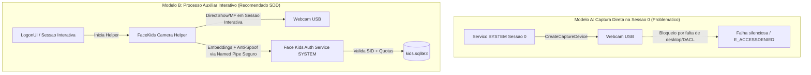

# Marco M2 — Câmera e Sessão Reais (Capacidade e Segurança)

**Status:** ESPECIFICAÇÃO PREPARADA / AGUARDANDO EVIDÊNCIAS DE M1  
**Metodologia:** Spec-Driven Development (SDD)  
**Data:** 2026-11-05  
**Ambiente Alvo:** Windows 10/11 — Webcam USB (DirectShow / Media Foundation / Sessão 0)  
**Objetivo:** Estabelecer a arquitetura técnica, os critérios de segurança e as salvaguardas para captura, liveness e concorrência facial antes de qualquer implementação de código.

---

## 1. Desafio 1: Captura de Webcam sob o Serviço SYSTEM (Sessão 0)

### 1.1 Análise do Problema
O Windows isola todos os serviços em segundo plano na **Sessão 0**. Desde o Windows Vista, a Sessão 0 não possui desktop interativo acessível. Drivers de captura de webcam (USB Video Class / DirectShow / Media Foundation) frequentemente falham ao tentar inicializar dispositivos de vídeo na Sessão 0 por restrições de permissão do subsistema gráfico e falta de sessão de console ativa vinculada ao dispositivo.

### 1.2 Modelos Arquiteturais Avaliados

### 1.3 Decisão de Engenharia SDD:
- **Prioridade 1:** Testar na máquina física se o driver da webcam USB específica (XWF-1080P) consegue capturar na Sessão 0 via script diagnóstico.
- **Plano de Contingência (Modelo B):** Caso a Sessão 0 seja bloqueada pelo SO/driver, implementar um processo auxiliar leve (`camera_helper.exe` ou Python) rodando no contexto da sessão de logon (`winlogon`/`LogonUI`) ou da sessão do usuário interativo, comunicando vetores processados via canal IPC com autenticação de processo e token SID.

---

## 2. Desafio 2: Liveness e Proteção Anti-Spoofing

### 2.1 Ameaças Mapeadas
- **Apresentação de Foto Estática:** Foto da criança impressa em papel ou exibida na tela de smartphone/tablet.
- **Apresentação de Vídeo:** Vídeo pré-gravado da criança em loop.
- **Rosto Parcialmente Oculto / Oclusão:** Criança com brinquedos, máscaras ou de perfil.

### 2.2 Estratégia de Mitigação em Estágios
1. **Estágio 1 (Movimento e Micro-expressões):**
   - Variação do vetor de landmarks faciais (5 pontos YuNet: olhos, nariz, cantos da boca) ao longo de $N$ frames consecutivos. Fotos estáticas apresentam dispersão de landmarks estritamente nula ou ruído de sensor característico.
2. **Estágio 2 (Desafio Ativo Opcional):**
   - Caso o limiar de confiança fique incerto, o sistema solicita um micro-desafio na tela de boas-vindas (ex.: piscar de olhos ou inclinação de cabeça de 15 graus).
3. **Estágio 3 (Fail-Closed):**
   - Em caso de inconsistência de liveness, o sistema nega o autologon silenciosamente e exige a senha/PIN convencional do Windows. **Nunca travar o computador em estado irrecuperável.**

---

## 3. Desafio 3: Concorrência e Múltiplas Faces Diante da Câmera

### 3.1 Cenários Familiares Típicos
- Dois ou mais irmãos sentados juntos na frente do computador.
- Um pai/mãe orientando o filho atrás da cadeira.
- Criança cadastrada sentada ao lado de amigo/visita não cadastrado.

### 3.2 Regra de Decisão Estrita:
| Cenário Detectado | Ação do Sistema | Justificativa |
|---|---|---|
| **Exatamente 1 face cadastrada com saldo** | `ALLOW` | Operação normal |
| **Mais de 1 face cadastrada presente** | `PROMPT_SELECTION` ou manter perfil com menor saldo/perfil atualmente ativo | Prevenir que o tempo de um irmão seja indevidamente cobrado da quota de outro |
| **1 face cadastrada + 1 face desconhecida** | `ALLOW` para o cadastrado com alerta visual suave | Não impedir uso acompanhado por pais ou amigos |
| **Múltiplas faces desconhecidas** | `DENY_UNKNOWN` | Segurança padrão |
| **Nenhuma face detectada** | `DENY_NOFACE` | Pausa contabilidade e não destrava |

---

## 4. Matriz de Tarefas de M2 (SDD Tasks)

| ID | Tarefa | Status | Dependência | Critério de Aceite |
|---|---|---|---|---|
| **T2.1** | Diagnóstico de captura na Sessão 0 via agendamento SYSTEM | ⏳ Aguardando M1 | Conclusão de M1 | Relatório confirmando se DirectShow abre câmera em Sessão 0 ou se requer Helper B |
| **T2.2** | Especificação do Protocolo IPC do Helper de Câmera (se Modelo B) | ⏳ Aguardando T2.1 | T2.1 = Modelo B | Contrato de dados binários do pipe com HMAC/SID |
| **T2.3** | Módulo de verificação de liveness temporal (YuNet landmarks jitter) | ⏳ Aguardando T2.1 | Modelos ONNX | Rejeição sintética de imagem estática em 100% dos testes de bancada |
| **T2.4** | Integração da política multi-face na `session_transition_policy.py` | ⏳ Aguardando T2.3 | `decide_child_transition` | Teste unitário cobrindo irmãos simultâneos sem débito cruzado |
