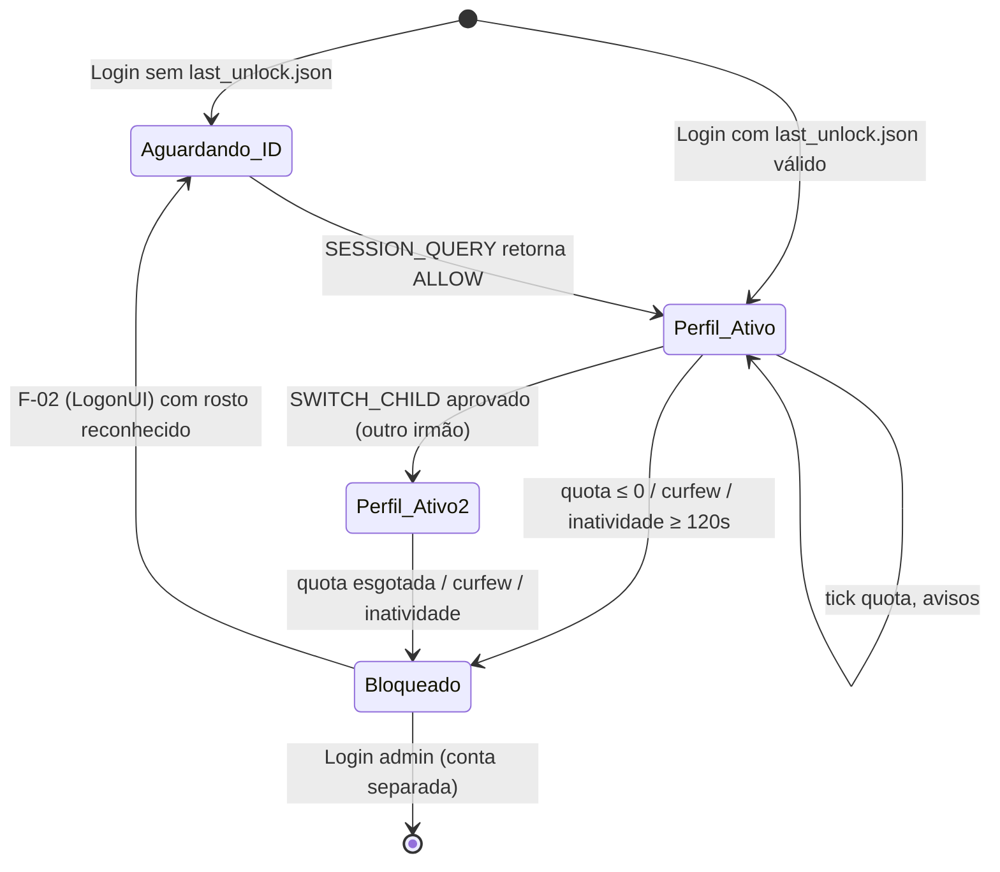

# Flows — Fluxos de Sequência de Produção (FaceControlKidsPC)

**Versão:** 1.0  
**Data:** 2026-11-05  
**Escopo:** Produção Windows física — conta `Filhos`

---

## Fluxo F-01 — Boot e Inicialização do Serviço Facial

```
[Boot do Windows]
      │
      ▼
Agendador de Tarefas (SYSTEM)
  └── Task "FaceKidsAuthService"
        └── executa: python -m facekids.boot_auth
              │
              ▼
        auth_service.py inicia
          ├── Carrega modelos YuNet + SFace (OpenCV DNN)
          ├── Abre banco kids.sqlite3 (SQLite WAL)
          ├── Cria Named Pipe: \\.\pipe\FaceKidsAuthPipe
          │     └── DACL: somente SID da conta Filhos pode conectar
          └── Loop: aguarda conexões de clientes no pipe
```

---

## Fluxo F-02 — Autenticação Biométrica na Tela de Logon (LogonUI)

```
[Usuário seleciona conta "Filhos" na LogonUI]
      │
      ▼
FaceKidsCredentialProvider.dll (C++ / COM)
  ├── Verifica SID: só aplica à conta Filhos
  ├── Exibe tile de reconhecimento facial
  ├── Captura frame da webcam USB
  │     └── Fallback: se webcam indisponível → retorna ERROR_CAMERA
  │
  ├── Conecta ao Named Pipe: \\.\pipe\FaceKidsAuthPipe
  │     └── Aguarda disponibilidade do pipe (WaitNamedPipe)
  │
  ├── Envia: "AUTH_QUERY\n" (ASCII, máx 512 bytes)
  │
  ▼
auth_service.py recebe AUTH_QUERY
  ├── Captura frame da webcam (OpenCV)
  ├── YuNet: detecta face(s) no frame
  │     ├── Nenhuma face → { "status": "DENY_NOFACE" }
  │     └── 1+ faces → extrai marcos faciais e embedding SFace da face principal
  ├── SFace: comparação 1:N com embeddings cadastrados no SQLite
  │     ├── Match (score ≥ threshold) → child_id identificado
  │     │     ├── PassiveLivenessDetector: variância temporal de micro-movimentos
  │     │     │     ├── Foto estática / spoofing → { "status": "DENY_SPOOF" }
  │     │     │     └── Rosto vivo confirmado → prossegue verificação
  │     │     ├── Verifica quota: storage.remaining(child_id, today) > 0?
  │     │     │     ├── SIM + horário permitido → { "status": "ALLOW", "child_id": N, ... }
  │     │     │     ├── Quota esgotada → { "status": "DENY_QUOTA" }
  │     │     │     └── Horário bloqueado → { "status": "DENY_CURFEW" }
  │     │     └── Grava last_unlock.json com child_id e timestamp (se ALLOW)
  │     └── Sem match → { "status": "DENY_UNKNOWN" }
  └── Resposta JSON serializada → pipe
      │
      ▼
FaceKidsCredentialProvider.dll recebe resposta
  ├── ALLOW → KerbInteractiveLogon(usuário="Filhos", senha="1") → AutoLogon
  ├── DENY_SPOOF → exibe mensagem "Foto ou tela estática detectada" e permanece bloqueado
  ├── DENY_QUOTA / DENY_CURFEW → exibe mensagem e permanece na LogonUI
  ├── DENY_NOFACE / DENY_UNKNOWN → repete captura ou exibe mensagem
  └── ERROR_CAMERA → exibe aviso (câmera ocupada) ou permite PIN manual
```

---

## Fluxo F-03 — Inicialização do Agente na Sessão Filhos

```
[AutoLogon concluído → Sessão "Filhos" aberta]
      │
      ▼
Agendador de Tarefas (Sessão Interativa Filhos)
  └── Task "FaceKidsFilhosAgent"
        └── executa: pythonw -m facekids.filhos_agent
              │
              ▼
        filhos_agent.run_agent()
          ├── Verifica USERNAME == "filhos" (encerra se diferente)
          ├── Cria Mutex "Local\FaceKidsFilhosAgentMutex" (encerra se duplicado)
          ├── Aguarda console ativo == "filhos" (loop 2s se não for)
          ├── Carrega Storage(kids.sqlite3) + LegacyLedgerQuota
          ├── Lê last_unlock.json → child_id, child_name (UI-only)
          │     ├── child_id encontrado → switch_child() + trigger_welcome_screen()
          │     └── Nenhum → toast "Olhe para a webcam" (modo aguardando)
          ├── Inicia InSessionFaceIdentifier (intervalo padrão: 120s)
          ├── Grava agent_heartbeat.json (primeira escrita)
          └── Entra no loop principal (ciclo ~2s)
```

---

## Fluxo F-04 — Loop Principal do Agente (Ciclo a cada ~2s)

```
while True:
  │
  ├─ [1] Verificar se console ativo == Filhos
  │       Não → sleep 2s, continuar
  │
  ├─ [2] Verificar mudança de data → reset de avisos de quota
  │
  ├─ [3] Ler last_unlock.json (UI-only)
  │       Evento mais recente que last_seen_ts + sessão ACTIVE + age < 60s
  │         → trigger_welcome_screen() (exibe card de boas-vindas)
  │
  ├─ [4] Obter estado da sessão (WTS)
  │       LOCKED → dismiss_welcome_screen(); não debitar; continuar
  │       ACTIVE (após LOCKED) → reset session_active_since_mono + last_active_time
  │
  └─ [5] Bloco ACTIVE:
        ├─ [5a] Heartbeat: a cada 10s → grava agent_heartbeat.json
        │
        ├─ [5b] idle_sec = min(GetLastInputInfo, active_duration)
        │
        ├─ [5c] Checar resultado facial pendente (InSessionFaceIdentifier)
        │        Resposta válida (SESSION_QUERY) com observação tipada:
        │          ALLOW + política SWITCH_CHILD → switch_child() + welcome + toast
        │          DENY_QUOTA ou DENY_CURFEW + SWITCH_CHILD → toast + LockWorkStation()
        │          ERROR_CAMERA → mantém perfil atual, sem ação
        │
        ├─ [5d] Agendar próxima SESSION_QUERY se intervalo decorrido
        │
        ├─ [5e] Checar curfew (store.is_curfew_active())
        │        Ativo → toast "Horário de Dormir" + LockWorkStation() + sleep 5s
        │
        ├─ [5f] Checar inatividade física:
        │        idle ≥ lock_sec (120s):
        │          → refund = min(idle, lock_sec)
        │          → store.refund(child_id, refund, today, session_epoch=current_session_epoch)
        │          → quota_refund_receipts persiste recibo único (idempotente)
        │          → LockWorkStation() + sleep 3s
        │        idle ≥ warn_sec (100s) e não avisado:
        │          → toast "Ausência Detectada"
        │        idle < warn_sec → reset inactivity_warned
        │
        ├─ [5g] Calcular delta de tempo ativo (0.5s ≤ delta ≤ 15s):
        │        child_id definido → LegacyLedgerQuota.active_tick(child_id, delta, today)
        │          → remaining = tick.remaining_seconds
        │          → update_balance(remaining)
        │          → Lembrete 30min se (now - last_welcome_reminder) ≥ 1800s e rem > 60s
        │          → check_notifications_and_lock(remaining) se tick.may_enforce_lock
        │               rem ≤ 0   → toast "Tempo Esgotado" + LockWorkStation()
        │               rem ≤ 60  → toast "1 Minuto Restante" (uma vez)
        │               rem ≤ 300 → toast "5 Minutos" (uma vez)
        │               rem ≤ 600 → toast "10 Minutos" (uma vez)
        │
        └─ sleep ~2s → repetir
```

---

## Fluxo F-05 — Watchdog Anti-Burla (AgentWatchdog)

```
[auth_service.py inicia como SYSTEM]
      │
      ▼
AgentWatchdogThread(check_interval=15s) iniciada como thread daemon
      │
      ▼  [a cada 15s]
AgentWatchdog.check_once():
  ├── Obter ID da sessão do console (WTSGetActiveConsoleSessionId)
  │     Falha / ID inválido → NO_ACTION
  ├── Obter username da sessão (WTSQuerySessionInformation)
  │     Não é "Filhos" → NO_ACTION, reset consecutive_failures
  ├── Obter estado da sessão (WTS)
  │     Não é ACTIVE (LOCKED/DISCONNECTED) → NO_ACTION, reset consecutive_failures
  ├── Verificar período de carência (now < grace_until)
  │     SIM → GRACE_PERIOD
  ├── Ler agent_heartbeat.json
  │     Heartbeat presente e age ≤ 45s → HEARTBEAT_OK, reset consecutive_failures
  │     Heartbeat ausente ou age > 45s:
  │       consecutive_failures += 1
  │       falha == 1 → schtasks /run FaceKidsFilhosAgent → RECOVERY_TRIGGERED
  │       falha ≥ 2 → LockWorkStation(session_id) + schtasks /run → PREVENTIVE_LOCK
  └── Aguarda 15s → repetir
```

---

## Fluxo F-06 — Verificação Facial em Sessão (SESSION_QUERY)

```
[InSessionFaceIdentifier.trigger_if_due()]
      │  (intervalo padrão: 120s, configurável)
      ▼
Thread worker:
  └── query_auth_service(timeout=6.5s, command="SESSION_QUERY")
        ├── WaitNamedPipe(pipe, 300ms) → timeout → retorna None
        ├── CreateFile(pipe, overlapped=True)
        ├── WriteFile("SESSION_QUERY\n") — overlapped, com deadline
        ├── ReadFile(2048 bytes) — overlapped, com deadline
        │     Timeout → CancelIoEx + GetOverlappedResult → retorna None
        └── Resposta → parse_local_json() → dict ou None

[filhos_agent loop]
  └── pipe_resp = identifier.check_result()
        Se resposta válida: → validated_face_observation()
          Resultado tipado (child_id, face_count, status, timestamp, detected_ids)
          Decisão via decide_child_transition() → SWITCH_CHILD / NO_CHANGE / etc.
```

---

## Fluxo F-07 — Desbloqueio por Inatividade com Reembolso

```
[Sessão ACTIVE, idle_sec ≥ lock_seconds (120s)]
      │
      ▼
filhos_agent detecta idle ≥ lock_sec
  │
  ├── child_id definido?
  │     SIM → refund = min(idle_sec, lock_sec)
  │             store.refund(child_id, refund, today)  ← débito negativo no SQLite
  │             rem = store.remaining(child_id, today)
  │             tracker.update_balance(rem)
  │             logger: "Reembolsados Xs de inatividade para Y. Saldo: Zs"
  │     NÃO → sem reembolso
  │
  ├── lock_current_session()  → user32.LockWorkStation()
  ├── inactivity_warned = False
  ├── session_active_since_mono = time.monotonic()
  └── sleep 3s → continuar loop
```

---

## Fluxo F-08 — Painel dos Pais (Admin Dashboard)

```
[Pai executa abrir-facekids.bat]
      │
      ▼
admin_auth.py → prompt de autenticação administrativa
  │  (senha do administrador local — separada da conta Filhos)
  ▼
admin_dashboard.py (Tkinter)
  ├── Lista crianças cadastradas (storage.py)
  ├── Ajuste de quota diária (minutos/horas)
  ├── Concessão de bônus de tempo
  ├── Configuração de horários de curfew
  ├── Galeria de fotos (avatar_utils.py)
  ├── Captura de novo perfil (children_pilot.py: 12 fotos sem retângulo)
  └── 3 temas visuais (Catppuccin Macchiato, etc.) — ui_theme.py
```

---

## Fluxo F-09 — Troca de Criança (Session Transition)

```
[SESSION_QUERY retorna ALLOW para criança diferente da atual]
      │
      ▼
validated_face_observation() → FaceObservation(child_id=X, status="ALLOW", ...)
      │
      ▼
decide_child_transition(
    current_id=tracker.current_child_id,
    detected_ids=observed.detected_ids,
    face_count=observed.face_count,
    idle_sec=idle_sec,
    candidate_id=observed.child_id,
    observation_age_seconds=age
)
      │
  SWITCH_CHILD → registered_name válido?
    SIM → tracker.switch_child(X, registered_name)
          session_active_since_mono = now
          last_welcome_reminder_mono = now
          trigger_welcome_screen()
          toast "Perfil Alternado: Olá, {registered_name}!"
    NÃO → logger.warning "Observação ignorada: perfil não cadastrado"
      │
  DENY_QUOTA ou DENY_CURFEW + SWITCH_CHILD:
    → toast "Acesso indisponível para {registered_name}"
    → lock_current_session()
```

---

## Estados da Sessão e Transições


